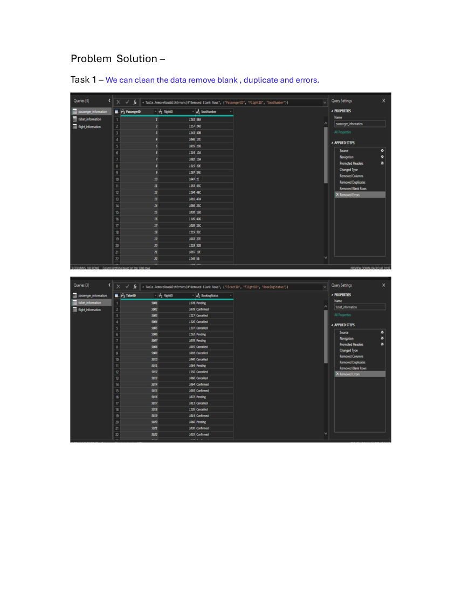
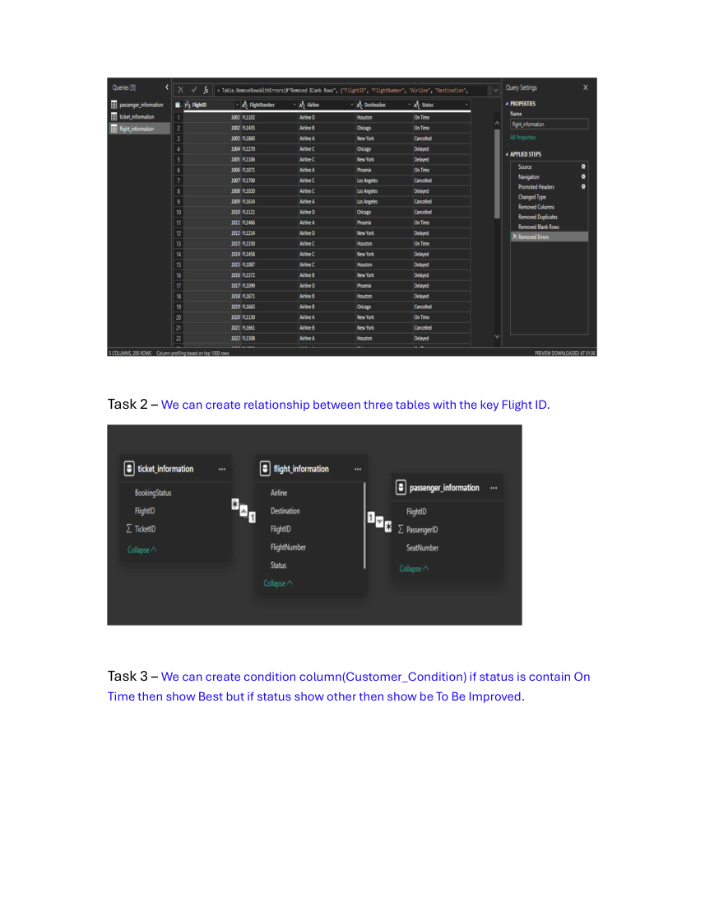
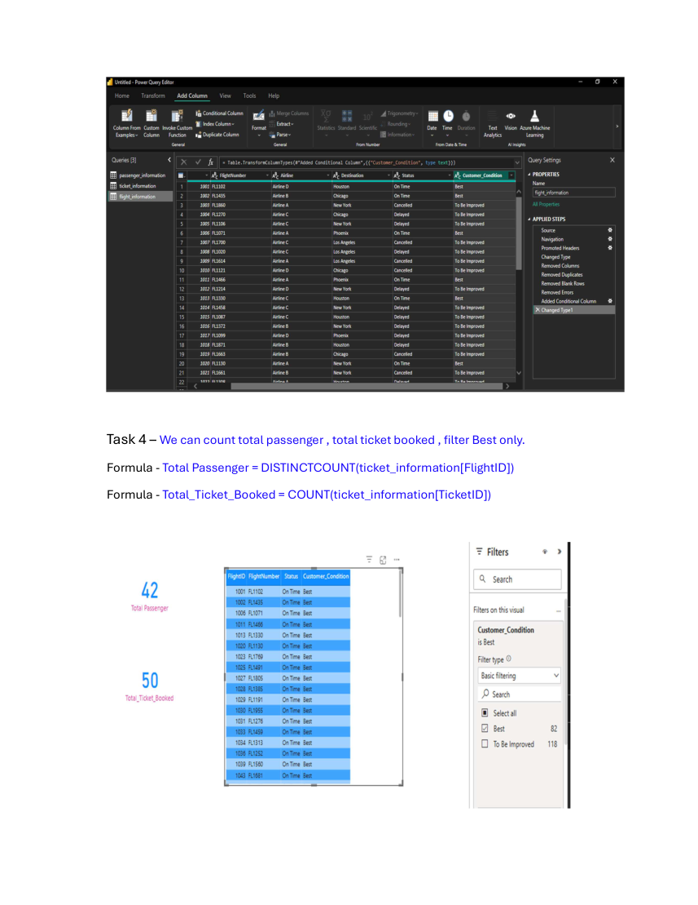
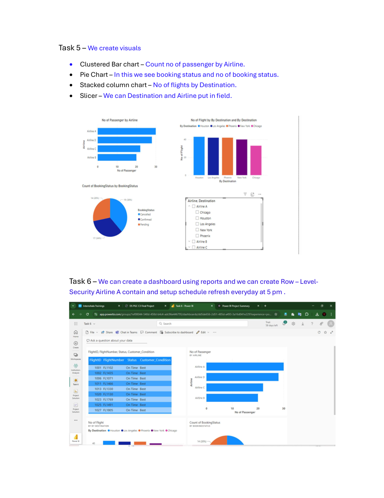

# Airline Data Management and Analysis Using Power BI

GitHub project folder for an airline analytics project using flight, passenger, and ticket data. Includes the uploaded project brief and solution PDF, source CSV files, solution-page images, dataset inventory, and starter DAX documentation.

## Objective
Analyze flight schedules, passenger details, and ticket bookings to support operational insights and passenger management.

## Repository structure
```text
airline-powerbi-github/
├── data/raw/                  # Original CSV datasets
├── data/processed/            # Cleaned/exported data
├── docs/                      # Project brief, solution, inventory
├── images/solution-pages/     # PNG images of the solution PDF
├── notes/                     # Solution summary
├── powerbi/                   # DAX templates and future .pbix report
├── screenshots/               # Add actual Power BI screenshots
├── report/                    # Add final PDF report
└── video/                     # Add presentation link/notes
```

## Included datasets
- `flight_information.csv`
- `passenger_information.csv`
- `ticket_information.csv`

See [`docs/dataset_inventory.md`](docs/dataset_inventory.md) for columns, row counts, and missing-value counts.

## Tasks from the project brief and solution
1. Clean blank records, duplicates, errors, missing values, and column formats in Power Query.
2. Create relationships between the three tables using `FlightID`.
3. Create `Customer_Condition`: `Best` when `Status` contains `On Time`, otherwise `To Be Improved`; extract the flight number from `FlightNumber`.
4. Create DAX calculations for passenger counts, tickets booked, and filtering `Best` flights.
5. Create visuals for passenger count by airline, ticket booking status, and flights by airline/destination, with Destination and Airline slicers.
6. Create the final dashboard, configure Row-Level Security for Airline A, and schedule refresh daily at 5 PM where supported.

## Solution PDF images
The images below are rendered from the uploaded solution PDF. They show the written solution, not screenshots from a running Power BI report.

### Solution page 1



### Solution page 2



### Solution page 3



### Solution page 4



## Screenshots to add after completing Power BI
Save your own screenshots in `screenshots/`:
- `01-power-query-cleaning.png`
- `02-data-model-relationships.png`
- `03-condition-column.png`
- `04-dax-measures.png`
- `05-passengers-by-airline.png`
- `06-booking-status-and-destination.png`
- `07-final-dashboard.png`
- `08-rls-refresh-settings.png`

Save the completed report as `powerbi/airline_analysis.pbix` and your final report PDF in `report/`.

## Metric validation
The solution PDF uses `DISTINCTCOUNT(ticket_information[FlightID])` for “Total Passenger”. This counts distinct flight IDs, not passenger IDs. See `powerbi/dax_measures.md` for a passenger-ID alternative and confirm which metric your assignment expects.

## Upload steps
1. Extract this ZIP.
2. Import the CSV files from `data/raw/` into Power BI Desktop.
3. Complete the analysis, save the `.pbix`, capture genuine screenshots, and add the final report.
4. Upload the extracted folder contents to a new GitHub repository.

**Status:** This folder includes the source data and documentation. It does not include a completed `.pbix` file or real screenshots of an implemented dashboard because these were not among the uploaded files. Check permission to share the data before making the repository public.
